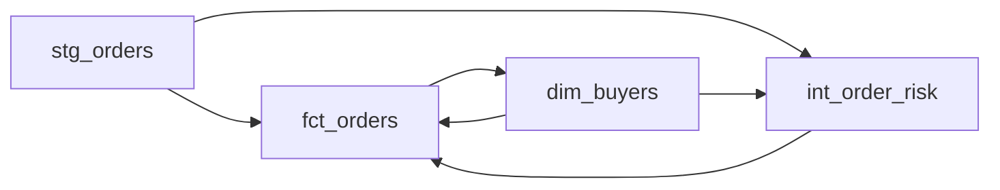
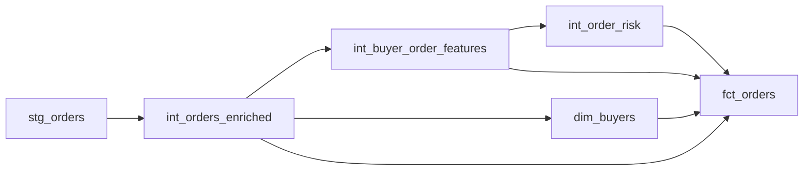

# Presentation — Order revenue that both teams can trust

**Audience:** Head of Operations, Finance Controller, Analytics Engineer  
**Run time:** 20 minutes total; 2 minutes on the dependency-cycle task  
**Supporting work:** `analysis/task1_analysis.py`, `README.md`, and the dbt models

## 1. Decision up front — 1 minute

Use separate operational and Finance products. Publish an hourly, provisional
Operations net-GMV view from current order state; preserve each Finance close
as an immutable monthly value and post approved post-close changes in the
current open month. Keep both the order snapshot and event feed until the event
source proves complete and correctly ordered.

## 2. What moved after close? — 4 minutes

Replay the existing calculation—EUR item price, excluding shipping, with every
status except `cancelled`—by order-created month. For the five months with at
least 90% event-time coverage, it declines **€120,255.40 (1.86%)** between
close and the post-close order-snapshot endpoint (about **€24.1k per month**).

| Month | Movement after close | Relative movement |
|---|---:|---:|
| May | -€27,407.57 | -2.32% |
| June | -€22,908.35 | -1.99% |
| July | -€14,701.38 | -1.13% |
| August | -€32,013.49 | -2.37% |
| September | -€23,224.62 | -1.58% |

The legacy calculation moves on close-to-current cancellation transitions:
`paid -> cancelled` (127 orders, -€79.7k; median 27.0 days after order),
`received_at_authentication -> cancelled` (43, -€38.6k; median 24.9 days), and
`placed -> cancelled` (3, -€1.9k; median 20.8 days). Use `orders.updated_at`
as the latest status change time; 36 cases with an at/before-close timestamp
disagree with the event replay and are excluded from post-close movement. A
corrected operational net also removes returns and authentication rejections;
the same endpoint replay declines **€289.5k** after close. Separately, the
event stream records 254 `delivered -> returned` transitions (median 18.3 days
after order, 8.4 after delivery; all within the 14-day window). Event-transition
counts and current snapshot endpoints do not reconcile one-for-one because the
event stream is incomplete.

The event-time close replay for May–September is within 0.03%–0.47% of the
reported Finance total. This supports (but does not prove) that the historical
close used the old non-cancelled formula. The refund-adjusted value is not the
same metric; do not silently relabel or replace the Board series.

## 3. Can the event table be our history? — 3 minutes

Not yet. There are **71,545 rows but 70,499 event IDs**; 1,046 duplicate
deliveries, 593 orders with no event, 387 latest-status mismatches against the
current orders table, and 2,236 orders whose latest event predates
`updated_at`. In ingestion order, 1,547 of 58,347 adjacent pairs regress in
event time. First-arrival lag has a 3.1-minute median and 19.1-minute p95, but
2,175 events arrive more than 24 hours late and 114 have negative lag.

The April close replay covers only 743 / 1,795 orders, so it is excluded from
the headline. July has two uncovered orders. Replay coverage also uses events
in the later extract, including late arrivals; it is not identical to the data
visible to Finance at the close.

## 4. Two consumers, two contracts — 2 minutes

* **Operations:** hourly net item GMV in EUR, shipping separate; count paid
  through completed orders, exclude unpaid `placed`, cancellation,
  authentication rejection, and return. It is current and can move. Report
  cancellation rate as cancelled orders / all orders, by order date, category,
  country, and buyer segment at order; expose rejection and return counts
  separately.
* **Finance:** the Controller owns the Board metric and its accounting policy.
  Keep the published close value exactly as reported. Proposed future close
  grain is the originating order month; freeze at the third business day, then
  post approved late cancellations/refunds as current-period adjustments that
  retain the original order/month. The supplied close values need Controller
  confirmation on shipping, FX, recognition, and whether returns/rejections
  are netted.

## 5. Build and history strategy — 3 minutes

The dbt project has raw CSV seeds, staging views, intermediate order and buyer
features, and two marts. `fct_orders` is the current one-row-per-order source
for Ops; the daily category/country/segment mart is rebuilt hourly. The Finance
mart is append-only by closed month. Run an hourly timestamp snapshot of
`orders.csv` as a fallback and retain the deduplicated event stream for
timestamped forensics. Neither alone is sufficient today: the snapshot can
miss intermediate transitions, while the event feed is incomplete and late.

## 6. Options, trade-offs, and cost — 3 minutes

**Rejected options**

1. Keep one current-state `fct_orders` for everyone: it lets late statuses
   rewrite closed months.
2. Use only `orders.csv`: it is overwritten and has no historical states.
3. Use only `order_status_events`: known gaps, duplicates, lateness, and
   ordering regressions make it unsafe as a source of truth.
4. Restate old Finance months on each run: mathematically simple, but recreates
   the exact Board/dashboard trust failure.
5. Hard-code `analytics.marts.fct_orders` to evade dbt's cycle: conceals
   lineage and build ordering rather than fixing the dependency.

**Cost:** moderate modeling complexity (two definitions, an hourly snapshot,
and explicit close handling); low compute at this dataset size (12,745 orders,
full-refresh fact and aggregate tables are practical). At production scale,
move facts to incremental processing, partition/event-watermark the history,
and monitor freshness, event completeness, and month-close reconciliation.
Maintenance is primarily source-contract monitoring and Finance approval of
close policy—not query tuning.

## 7. Cycle repair — 2 minutes

Arrows point from an upstream model to its downstream consumer. These graphs
focus on the models involved in the cycle; the original graph is cyclic, not
a DAG.

**Before: cyclic dependencies**

`fct_orders` needs both `dim_buyers` and `int_order_risk`; risk needs the
dimension; the dimension aggregates the fact. dbt refuses this because it
cannot topologically order a cyclic DAG. A hard-coded relation hides the edge
from dbt and breaks lineage and reliable environment selection.

**After: acyclic dependencies**

`buyer_segment` on a fact is the segment **at that order**, derived only from
prior submitted orders; `buyer_segment_current` remains on the current buyer
dimension. `is_high_risk` is evaluated at order time: first order and
item-price GMV > €1,000. The `fct_buyer_segment_is_as_of_order` test fails if
the current segment is substituted for the historical one; 3,528 orders differ
from today's segment in this sample.

## 8. What would change the recommendation? — 2 minutes

Promote the event feed to primary history only after it has replay/backfill,
100% order coverage, stable event IDs, no conflicting payloads or chronology
regressions, and lateness within an agreed SLA across a representative period.
If the Finance Controller confirms a different recognition, return, shipping,
or FX policy, change the prospective Finance contract and preserve old
published values with a documented cutover. If reconciliation shows that an
immutable append-only close cannot be maintained from the ledger, redesign the
close interface before publishing a new metric.
